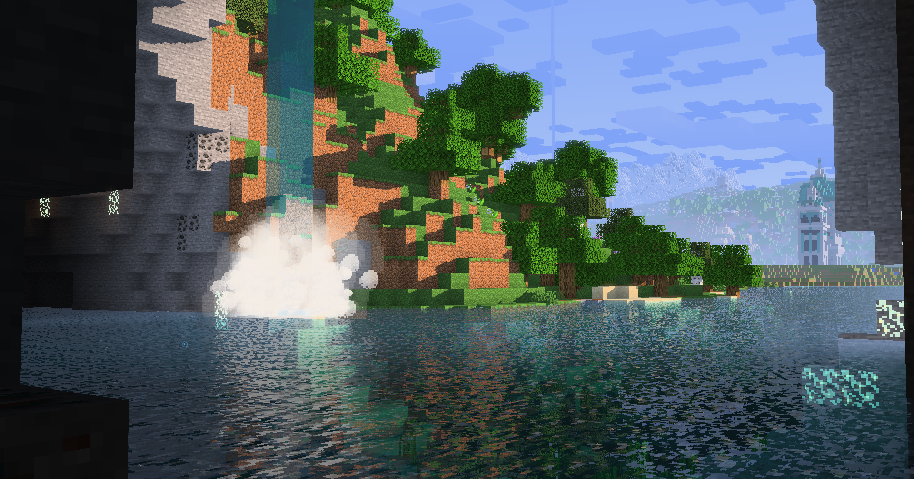

# Vibrant Visuals Shader

Vibrant Visuals Shader brings a Bedrock-inspired atmosphere to Minecraft Java Edition while keeping Minecraft's pixel style. It combines colorful biome skies, reflective water, animated caustics, volumetric fog, and glowing materials, with settings that let you shape the look and choose your performance level.

This is a fork of [Miniature shader by ukrech](https://github.com/mateuskreuch/minecraft-miniature-shader), maintained by DigitalDan68. Version **1.1.0** is available from [GitHub Releases](https://github.com/DigitalDan68/vibrant-visuals-shader/releases/latest).

## Features

### Water

- Animated Bedrock water normal textures with pixel-style waves, reflections, and sun and moon glints.
- Turquoise depth coloring with absorption and scattering controls for CDOM, chlorophyll, suspended sediment, and biome tint.
- Underwater refraction with a textured overhead viewing window and subtle underside reflections.
- Animated Bedrock caustics aligned to Minecraft's 16×16 block pixel grid, with adjustable scale, strength, animation speed, and contrast.
- Underwater sunlight shafts that respond to water murkiness and fade out by 30 blocks. Ultra enables them by default.
- Separate water and atmospheric volumetric quality settings, each supporting up to 128 samples.
- Improved underwater visibility with Conduit Power and Night Vision.

### Atmosphere and weather

- Biome-specific sky and fog colors with direct cross-dissolve transitions.
- Sandy deserts, orange Badlands and Savannas, dark green swamps, aquamarine jungles, cool snowy biomes, and dense gray Pale Garden fog.
- Dense sandy storm fog and square wind-blown particles in desert and Badlands biomes. Thunderstorms increase wind speed; rain uses fewer particles.
- Savanna weather darkens the sky without sandy storm fog or particles.
- Height fog, atmospheric light shafts, twilight rays, and adjustable weather opacity.
- Cave sunlight and moonlight shafts with soft shadow sampling and a gradual depth fade. Moon rays use one quarter of daytime strength.
- Filtered volumetric shadow sampling and stratified integration across air, water, and dimension fog.
- Particle Rain support for rain sprites generated from the stock rain texture.
- Distant Horizons support for distant terrain and water, with cloud compatibility.

### Lighting and materials

- Directional shadows with filtered edge coverage, colored stained-glass and translucent-ice shadows, and optional cloud shadows.
- Colored glass shadows enabled by Ultra; cloud shadow strength defaults to zero.
- Screen-space reflections for supported blocks, glass, and water.
- Integrated PBR materials with specular capped at 25%, including metallic rail sections and minecarts.
- Resource-pack normal and specular maps can override the integrated material defaults.
- Selective emission for lantern interiors, torch tips, glow lichen highlights, sculk and shrieker flecks, berry-bearing vines and glow berry items, End Crystal cores, crying obsidian cracks, vault light panels, Creaking eyes, and activated Creaking hearts.
- Frame-based native animation masks: changing texels glow as they brighten, while static texture details stay unlit. Authored resource-pack emission maps retain priority.
- Better Nether Portals support, including horizontal portals, restrained surface emission, and stronger bloom.
- Bloom, ambient occlusion, exposure controls, and adjustable color grading.
- Support for Darkness, Blindness, Night Vision, and Nausea visual effects.
- Optional glowing ores and waxed-block highlighting.

### Dimensions and customization

- Overworld, Nether, End, and The Sift support.
- Stars against a black End sky, with Enderman-purple flashes that illuminate a gradient rising from the void.
- Configurable Nether and End fog and ambient lighting, plus End sky glow.
- The Sift's own sky palette, mist, ambient glow, light shafts, and atmospheric motes.
- **Lowest, Low, Normal, High, and Ultra** presets, with separate menus for materials, lighting, water, atmosphere, dimensions, and performance.
- LambDynamicLights compatibility and an optional companion resource pack for enchanted items, custom emitters, and supported emissive mobs.

## Installation

### Shader pack

1. Set up **Minecraft Java 26.3** with **Fabric**, **Iris**, and **Sodium**. Distant Horizons is optional; install it if you want distant terrain rendering.
2. Download **Vibrant Visuals Shader v1.0.0.zip** from [Releases](https://github.com/DigitalDan68/vibrant-visuals-shader/releases/latest).
3. Place the ZIP in your instance's `shaderpacks` folder. Keep it zipped.
4. Launch Minecraft, open **Options → Video Settings → Shader Packs**, and select the shader.
5. Open the shader settings and choose a quality preset. Start with **Normal** or **High**, then adjust to suit your system.

In Prism Launcher, right-click your instance and open its Minecraft folder to find `shaderpacks`. The shader ZIP must contain the `shaders` folder directly at its root.

### Optional Dynamic Lights resource pack

1. Install **LambDynamicLights** for your Minecraft version.
2. Download **Vibrant Visuals Dynamic Lights v1.0.0.zip** from the same release.
3. Place it in your instance's `resourcepacks` folder and enable it in Minecraft's Resource Packs menu.
4. Enable **LambDynamicLights Compatibility** under the shader's **Lighting** settings.

The companion pack targets Minecraft 26.3. Its mob rules apply to entire species; see [its README](companion-resourcepack/README.txt) for details. Dynamic lighting comes from LambDynamicLights; the shader retains emissive textures and bloom.

## Compatibility

The current release targets Minecraft 26.3 and requires **OpenGL 4.3**. Native macOS OpenGL is unsupported. Support for older Minecraft versions is planned.

Caustics through underwater glass enclosures are not currently supported. The Sift's atmosphere applies when the corresponding dimension mod is installed.

## Credits

Original Miniature shader by **ukrech (Mateus A. Kreuch)**. Fork maintained by **DigitalDan68**. The original MIT license and copyright notice are retained in [LICENSE](LICENSE), and the original README is preserved in [README_ORIGINAL.md](README_ORIGINAL.md).

Minecraft water asset origins are documented in [WATER_ASSET_SOURCE.md](shaders/textures/WATER_ASSET_SOURCE.md). This is not an official Mojang or Microsoft shader pack.

## Disclaimer 

This Shader fork heavily relies on Generative AI (Codex) for code. I'm not the best programmer but plan on learning as time goes on. I really want this shader to just exist and this was my way of getting it here. Thank you for your understanding.  

### Texture compatibility

Particle Rain sprite matching and the integrated animated-emission envelopes target the stock Minecraft textures. Resource packs that replace those textures may need matching references or authored emission maps.
